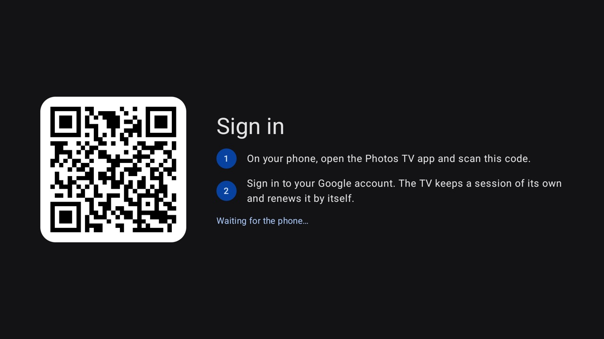
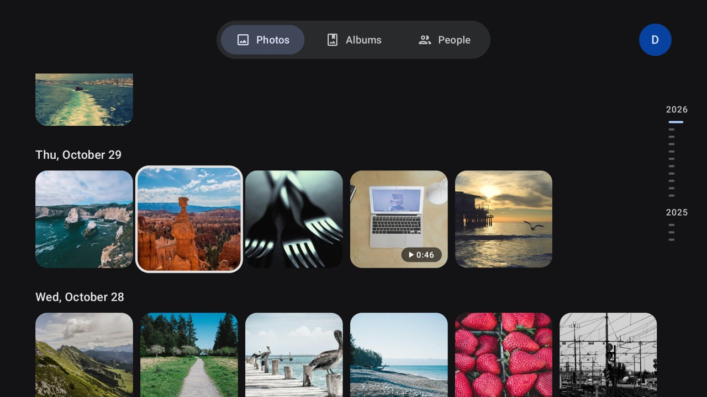
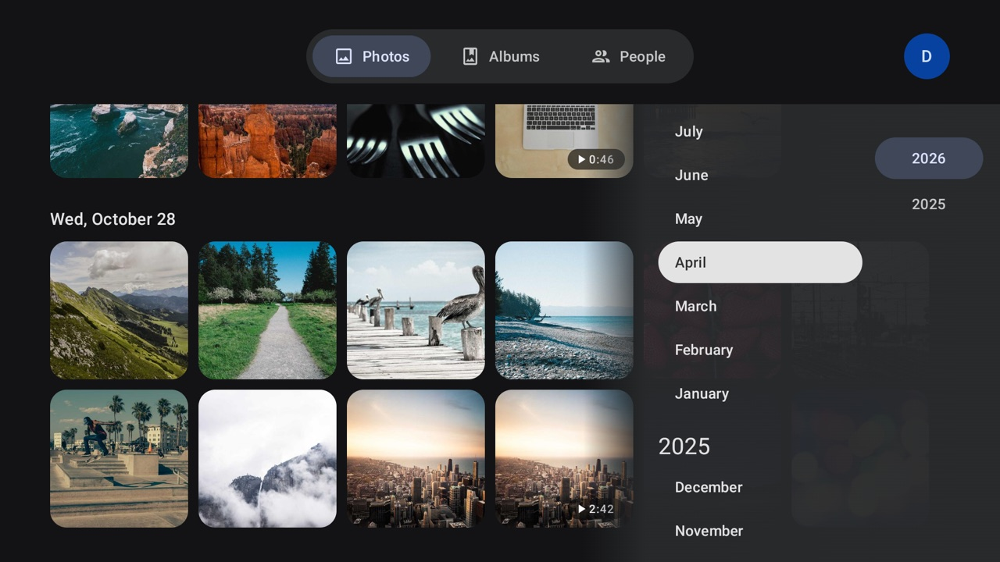
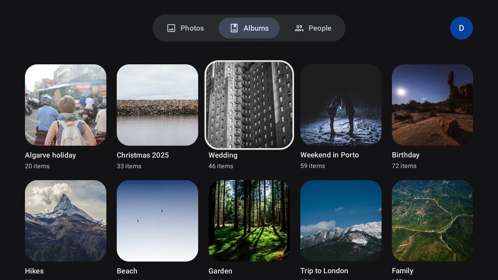
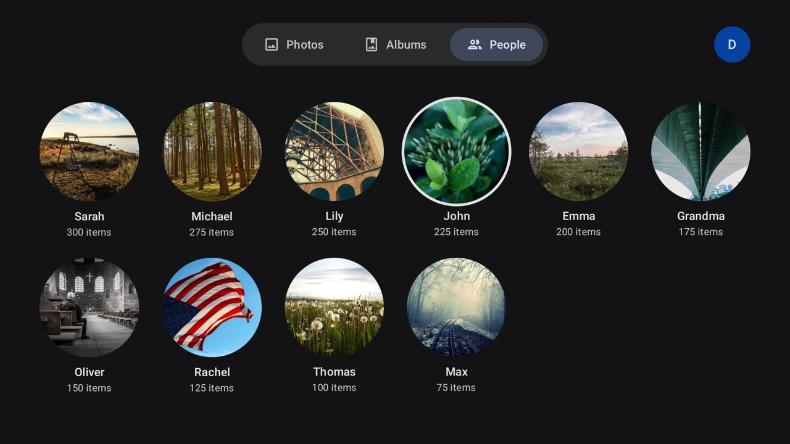
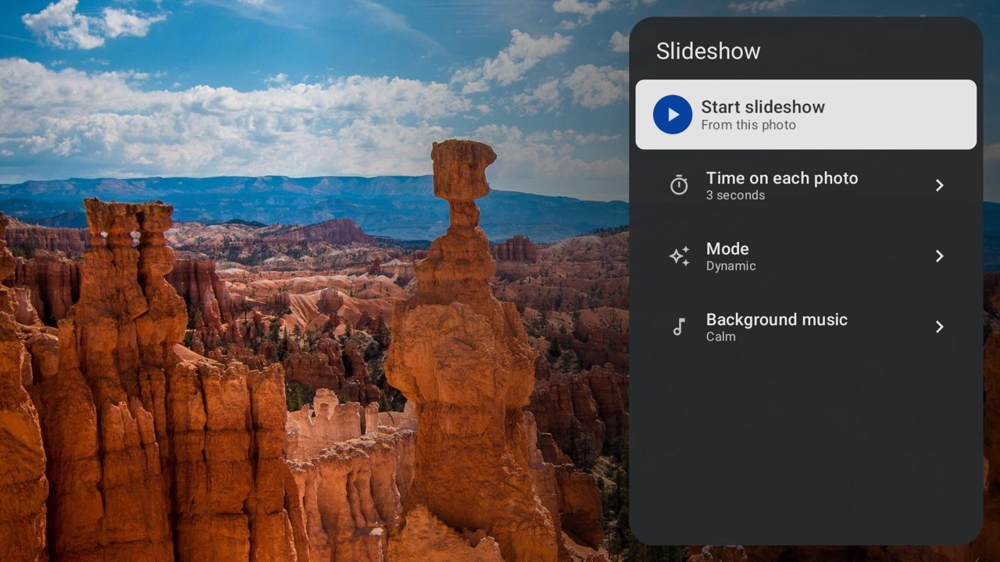

# Photos for Google TV

A Google Photos client for Android TV and Google TV devices running Android 14 or later, built with
Jetpack Compose for TV (Material 3). It's developed and tested on the Google TV Streamer, and draws
photos at the TV's native resolution, 4K included. It's an unofficial, personal project, not affiliated with or
endorsed by Google, and it relies on private Google endpoints (see
[How it talks to Google Photos](#how-it-talks-to-google-photos)).

| | |
| --- | --- |
|  |  |
| **Sign in**: scan the QR code with the phone app | **Photos**: the whole library, grouped by day |
|  |  |
| **Timeline**: jump to any month or year | **Albums**: owned and shared |
|  |  |
| **People**: the faces Google Photos recognised | **Viewer**: full screen, with the date and place |
|  |  |
| **Zoom**: 2× and 5×, sharp from the original | **Slideshow**: duration, mode and music |

<sub>Screenshots from the emulator's demo library, with images from picsum.photos.</sub>

- **Languages**: English, Portuguese (European), Spanish, French and German, picked from the TV's
  system language (or the app's own language setting, where Android offers one); any other language
  gets English. Dates, month names and the video player's controls follow the same language. The
  phone app does the same with the phone's language
- **Tabs**: Photos, Albums and People along the top; moving along them switches page
- **Account**: your Google account picture at the top right, past the tabs; select it to see the
  account, switch to another account signed in on the TV, add one ("Add another account", which
  shows the QR code for the phone again; Back cancels) or sign out. Signing out removes only the
  account showing, and the next one takes its place
- **Back**: on a list, moves focus back to its first item (the newest photo, the first album or
  person); pressed again there, it exits the app
- **Photos**: your whole library as a timeline, grouped by day, newest first
- **Timeline**: on Photos, moving right past the last column opens a list of years and months
  (a side menu). Up/down pick a month, OK jumps there; the grid then fills in
  newer photos as you scroll up. Moving right again reaches a column of years: up/down move
  between years, OK jumps to that year's newest month, left returns to its months. The month list takes one small request per month with photos
  on first use, and is cached after that.
- **Albums**: your albums (owned and shared), and the photos in each one
- **People**: the people (and pets) Google Photos recognised, as round faces with their name and
  number of photos; open one to see their photos by day
- **Viewer**: full-screen at the TV's native resolution. The app's window is 1080p even on a 4K
  TV (the system scales it up), so a photo first shows at 1080p, which arrives almost at once,
  then fades to its 4K version, drawn in a surface of its own that the TV shows unscaled. The
  photos either side are prepared in the background, so ◀ ▶ land on sharp photos, and a photo
  you rest on in the grid is fetched ahead of opening it. Videos stream over Google's adaptive HLS
  (starts fast, steps up to 1080p, which is the most Google Photos streams), with the 1080p/720p
  files and then the original upload as fallbacks. 4K originals can't be streamed: their server
  ignores byte-range requests. ◀ ▶ to browse, ▲ ▼ to show the date and place (when Google
  Photos has one), OK to play a video, Back to return to the grid.
- **Zoom**: OK on a photo zooms to 2×, again to 5×, and a third time back to the whole photo.
  Zoomed in, the d-pad moves around it (in smaller steps while held), and the bottom right shows
  the whole photo in miniature with the part on screen outlined. The zoomed view is drawn from the
  original photo, downloaded on the first zoom and decoded only a screen's worth at a time, so it
  stays sharp at 5×; until that arrives, and briefly past its edges while moving, it shows the
  photo scaled up. Back returns to the whole photo; holding OK still opens the slideshow menu.
  Videos don't zoom
- **Video**: while a video plays, a progress bar shows the time played and the length; ◀ ▶ (or rewind/fast
  forward) jump 10 s, 30 s while held, OK or play/pause pauses, and Back stops it
- **Slideshow**: in the viewer, hold OK (or press the menu key) on a photo for a panel with
  "Start slideshow", how long each photo shows (3 to 30 s), the mode and the background music. Play/pause
  on a photo starts it too. The slideshow shows photos only, skipping videos, and can't start from
  one. OK or play/pause pauses it, ◀ ▶ step between photos, Back ends it on the photo showing.
  Leaving the app pauses it. The settings are kept between launches. The next three photos are
  downloaded ahead, and a photo stays on screen until the next is ready: in 4K, or at 1080p after
  3 s more, with a photo that won't load within 15 s passed over. "Mode" picks Static (one
  photo after another) or Dynamic: each photo dissolves into the next over 0.7 s and slowly zooms
  in or out (by 8%, alternating), drawn into the 4K layer frame by frame; a photo whose 4K version
  isn't ready yet moves at 1080p until it is
- **Music**: "Calm" and "Upbeat" stream popular instrumental tracks with those tags from
  [Jamendo](https://www.jamendo.com) (Creative Commons music), shuffled, fading in and out with the
  slideshow; the track and its artist show for a few seconds when it starts. With the music off,
  music already playing in another app (say Spotify) carries on under the slideshow

The TV keeps each account's master token (encrypted), the slideshow settings, the timeline's month list
and Coil's image cache (up to 768 MB on disk). Signing out deletes that account's token and clears the
image cache.

## How it talks to Google Photos

In March 2025 Google removed library-wide read access from the public Photos Library API. Third-party
apps can now only see photos they uploaded themselves, or photos picked one session at a time with the
Picker API. So this app uses the same private `batchexecute` RPC endpoint that photos.google.com uses
(RPC ids from [Google Photos Toolkit](https://github.com/xob0t/Google-Photos-Toolkit)):

| Feature | RPC |
| --- | --- |
| Timeline | `lcxiM` |
| Albums | `Z5xsfc` |
| Album contents | `snAcKc` |
| People | `yQelMe` with `[pageToken, null, null, [[1, null, 1]]]` |
| A person's photos | `EzkLib` (search) with `["", [[1, personId, 0, 0]], pageToken]` |

Signing in is done from a phone. Google blocks every route on the TV itself for a third-party app:
its normal sign-in page refuses WebViews, and the device sign-in flow requires a Play Services
attestation (`MissingDroidguard`) that only Google's own apps can produce. The one page it does allow
in a WebView is `accounts.google.com/EmbeddedSetup`, the sign-in of Android's setup wizard. The phone
app shows it and sends the one-time `oauth_token` it leaves to the TV, which trades it for an Android
master token (the flow of [gpsoauth](https://github.com/simon-weber/gpsoauth)). From the master
token the TV makes its own web session whenever it needs one: OAuthLogin access token → uberauth →
`MergeSession`, as Chrome on Android does.

**Caveats:** the endpoint is undocumented and against Google's ToS for third-party clients. It can
change without notice. If it does, `data/PhotosApi.kt` is the only file that should need updating.
The sign-in endpoints are just as unofficial, and `data/GoogleAccount.kt` is where they live. The
master token gives full access to the Google account until you change its password or remove the
device in your account's security settings; the TV keeps it encrypted with a key in the Android
Keystore, and signing out deletes it. Each account added keeps its own master token; the web session
belongs to one account at a time, so switching makes a new one from that account's token.

## Build

You need Android Studio (its bundled JDK 21) and SDK platform 37.

```bash
JAVA_HOME="/Applications/Android Studio.app/Contents/jbr/Contents/Home" ./gradlew :app:assembleRelease
```

The release build is minified and signed with the debug key, for sideloading.

The slideshow music needs a Jamendo API client id: register an app (free, non-commercial) at
[devportal.jamendo.com](https://devportal.jamendo.com) and add it to `local.properties`, which stays
out of git. Without it, the music options are shown but can't be picked.

```properties
jamendo.clientId=<your client id>
```

On an emulator (for example the Google TV AVD), the debug build skips sign-in and shows a made-up
library with images from picsum.photos, so the UI can be tried without a Google session
(`app/src/debug/.../Demo.kt`). Release builds, and debug builds on a real TV, always use Google Photos.

```bash
JAVA_HOME="/Applications/Android Studio.app/Contents/jbr/Contents/Home" ./gradlew :app:installDebug
```

The phone app is a module of its own (Android 10 or later):

```bash
JAVA_HOME="/Applications/Android Studio.app/Contents/jbr/Contents/Home" ./gradlew :phone:assembleRelease
```

## Install on your TV

These steps are for Google TV (the menu names differ a little on other Android TV devices).

1. On the TV, go to **Settings → System → About** and press **Android TV OS build** 7 times to
   unlock developer options.
2. Go to **Settings → System → Developer options** and turn on **Wireless debugging**. Open it, choose
   **Pair device with pairing code**, and note the IP, port and code.
3. On the Mac:

```bash
adb pair <tv-ip>:<pairing-port>
```

```bash
adb connect <tv-ip>:<debug-port>
```

```bash
JAVA_HOME="/Applications/Android Studio.app/Contents/jbr/Contents/Home" ./gradlew :app:installRelease
```

The app shows up under **Apps** on the Google TV home screen as **Photos** (**Fotos** in Portuguese, Spanish and German).

Install the phone app the same way, with wireless debugging on the phone, or copy
`phone/build/outputs/apk/release/phone-release.apk` to it and open the file:

```bash
JAVA_HOME="/Applications/Android Studio.app/Contents/jbr/Contents/Home" ./gradlew :phone:installRelease
```

It shows up as **Photos TV** (**Fotos TV** in Portuguese, Spanish and German).

## Sign in

1. Open the Photos app on the TV. Its sign-in screen shows a QR code.
2. On the phone, open **Photos TV**, choose **Scan QR code** and scan it. The first time, allow the
   app to find devices on the local network.
3. Sign in to your Google account on the page that opens, and accept Google's terms if asked.
4. The phone says **Signed in** and the TV opens your library.

The phone and the TV must be on the same network, with the Photos app open on the TV. Nothing stays on
the phone: it clears its cookies once the TV has answered. The TV makes a new web session by itself
whenever Google ends the current one, so you only sign in again after signing out (select your
picture at the top right, or press Back on the error screen) or if the master token is revoked.

The token travels encrypted (AES-GCM, with a key derived from the pairing code in the QR code), and
the TV refuses anything that doesn't decrypt with its code, is older than 10 minutes, or repeats an
earlier request.

## License

[MIT](LICENSE). The launcher banner's text is drawn from Roboto (Apache 2.0); slideshow music comes from
Jamendo under each track's own Creative Commons license and isn't part of this repository.
